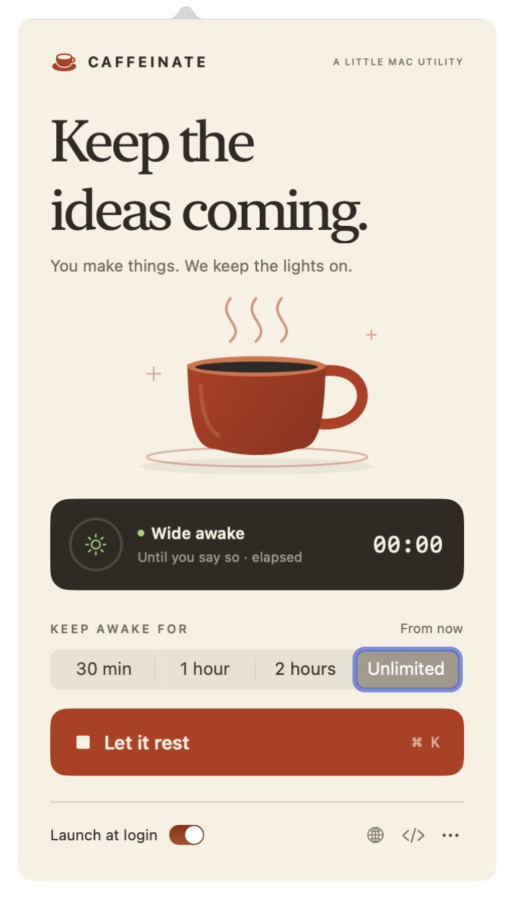
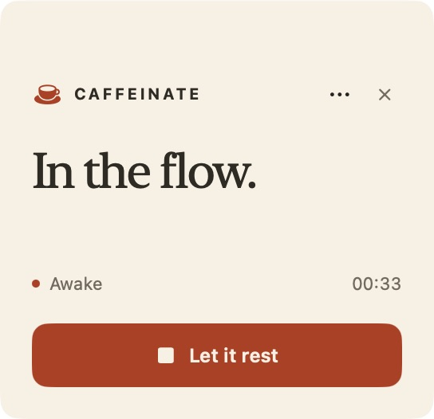

<p align="center">
  
</p>

<h1 align="center">Caffeinate</h1>
<p align="center"><strong>Small cup. Long session.</strong></p>
<p align="center">A tiny native macOS app that keeps your Mac awake while you make things.</p>
<p align="center">Swift + SwiftUI · macOS 13+ · Apple Silicon & Intel · MIT</p>
<p align="center">Made by <a href="https://github.com/paolo-trivi">@paolo-trivi</a> · <a href="https://trivisonno.dev">trivisonno.dev</a> · <a href="https://github.com/paolo-trivi/caffeinate-ui">Source on GitHub</a></p>
<p align="center"><a href="https://github.com/paolo-trivi/caffeinate-ui/releases/download/v1.0.0-preview.1/Caffeinate-macOS-universal.dmg"><strong>Download for macOS</strong></a> · <a href="https://github.com/paolo-trivi/caffeinate-ui/releases/tag/v1.0.0-preview.1">Release notes</a></p>

Long builds. Remote sessions. One more good idea. Put `caffeinate -disu` in your menu bar, with a small floating desktop panel when you want it closer.

<p align="center">
  
  
</p>

## What you get

- One click to keep your Mac awake, one click to let it rest.
- Sessions for 30 minutes, 1 hour, 2 hours, or until you stop them.
- A countdown for timed sessions and elapsed time for unlimited sessions.
- Change the duration while running; a timed session restarts from that moment.
- An optional desktop panel you can drag anywhere. It stays above other windows and across Spaces.
- Optional launch at login through macOS settings. Sessions always start manually.
- A menu bar icon that changes with the session state, plus right-click quick controls.
- Command-K to start or stop while the panel is focused.
- No accounts, analytics, network requests, external packages, or administrator access.

## Install

[Download the universal DMG](https://github.com/paolo-trivi/caffeinate-ui/releases/download/v1.0.0-preview.1/Caffeinate-macOS-universal.dmg), open it, and drag Caffeinate to Applications. Builds include both Apple Silicon and Intel binaries. No GitHub account or Xcode is needed. A [ZIP download](https://github.com/paolo-trivi/caffeinate-ui/releases/download/v1.0.0-preview.1/Caffeinate-macOS-universal.zip) is also available.

Preview builds have a local ad hoc signature and are not notarized. macOS may block a downloaded app; if you trust and have verified it, use **System Settings → Privacy & Security → Open Anyway**. You can also build locally using the instructions below. No Apple Developer account is needed.

## Build from source

Requires macOS 13 or later and a Swift 6 toolchain (Xcode 16 or later, or matching Command Line Tools). No Apple Developer account or paid membership is required.

Clone the repository and install:

```sh
git clone https://github.com/paolo-trivi/caffeinate-ui.git
cd caffeinate-ui
./scripts/install.sh
```

This builds the app, installs it in `~/Applications`, and opens it. Look for the cup in your menu bar. Use the **More options** menu to show the desktop panel.

To update, quit the app and run the same command again. To uninstall, quit and remove `~/Applications/Caffeinate.app`. If you enabled launch at login, turn it off first in the app or System Settings.

## Build and package

```sh
swift test
./scripts/build.sh              # Build for this Mac
./scripts/build.sh --universal  # Build for Apple Silicon and Intel
./scripts/package.sh            # Universal .app, .zip, and drag-to-Applications .dmg
```

Builds appear in `dist/`. Open `Package.swift` in Xcode to work on the app.

Build scripts apply a local ad hoc signature. They don't use a Developer ID, contact Apple, or notarize the app. Public distribution without Gatekeeper warnings requires Developer ID signing and notarization; those are not part of this project setup.

## How it works

The app launches the system's `/usr/bin/caffeinate` directly, without a shell:

```sh
caffeinate -disu -w <app-pid> [-t <seconds>]
```

`-d` prevents display sleep, `-i` prevents idle system sleep, `-s` prevents system sleep on AC power, and `-u` declares user activity. On an unlimited session, the `-u` assertion itself lasts five seconds; the other assertions remain active. Timed sessions use caffeinate's own timeout. `-w` releases assertions if the app exits, including after a crash. Stopping a session terminates only the process the app created.

The desktop panel is an ordinary native floating window. It shares the app's process and session; it is not a WidgetKit widget and doesn't appear in the macOS widget gallery.

Keep the lid open. This prevents idle sleep; it cannot override lid-close sleep, a deliberate Sleep command, critical battery conditions, VPN idle policies, network failures, or remote server timeouts. Display sleep prevention also increases power use.

Implementation references: [Apple's Service Management API](https://developer.apple.com/documentation/servicemanagement/smappservice) and the `caffeinate(8)` manual shipped with macOS (`man caffeinate`).

## Contributing

Keep changes small, native, and dependency-free. Run `swift test` and `./scripts/build.sh` before submitting a change. UI changes should include a screenshot. Bug reports should include the macOS version, chip architecture, and steps to reproduce.

## License

[MIT](LICENSE).
